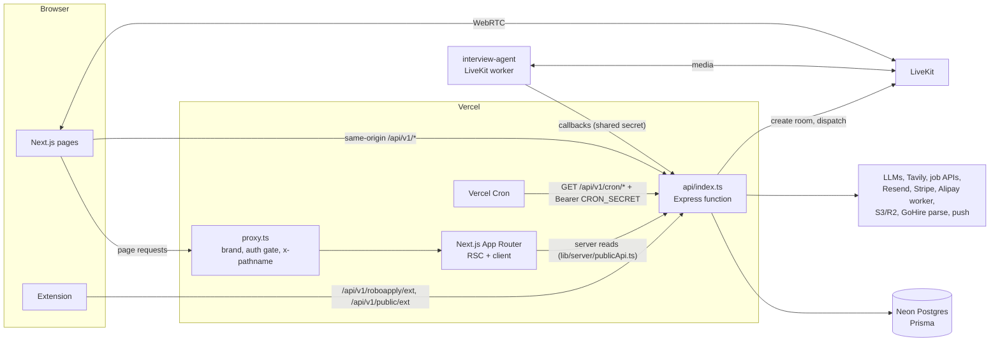

# System architecture

As of 2026-11-03 (main @ b89d5256).

This chapter explains how the pieces fit together at runtime: what runs where, how a request travels, how one deployment serves two brands, how sessions work, what runs in the background and how configuration is layered. For the full design record of the dual-brand product see [docs/jobright-clone/ARCHITECTURE.md](../jobright-clone/ARCHITECTURE.md) (about 3,000 lines; this chapter links into it rather than repeating it). Related handbook chapters: [03-codebase-map.md](03-codebase-map.md), [04-local-development.md](04-local-development.md), [05-data-model.md](05-data-model.md), [09-deployment-and-operations.md](09-deployment-and-operations.md).

## 1. Components

| Component | Where | Runs as | Notes |
|---|---|---|---|
| Web app | repo root: [`app/`](../../app), [`proxy.ts`](../../proxy.ts), [`next.config.mjs`](../../next.config.mjs) | Next.js 16 App Router; on Vercel the framework build, elsewhere `output: 'standalone'` | `proxy.ts` is Next 16's renamed `middleware`. |
| API | [`server/src/app.ts`](../../server/src/app.ts) | Express (TypeScript, ESM, NodeNext). On Vercel one serverless function, [`api/index.ts`](../../api/index.ts), that re-exports the compiled `server/dist/app.js`. Locally `tsx watch` with `app.listen`. | `maxDuration: 300`, 2 GB, in [`vercel.json`](../../vercel.json). |
| Voice worker | [`interview-agent/`](../../interview-agent) | Long-running `@livekit/agents` Node process (own `package.json`, build, env) | Cannot run on Vercel. Joins LiveKit rooms on explicit dispatch and posts transcripts back to the API. |
| Parley pilot | [`server/src/interview-engine/parley/`](../../server/src/interview-engine/parley) | External WebRTC interview service (separate repo); the API only creates sessions and receives webhooks | Off unless `INTERVIEW_ENGINE_PARLEY_PILOT` is `all` or a list of users. |
| Browser extension | [`extension/`](../../extension) | MV3 extension, two brand builds; own package, tests and build | Fills forms, never submits (ruling D1, enforced by `npm run check:extension`). |
| Database | [`server/prisma/schema/`](../../server/prisma/schema) (multi-file) | Postgres on Neon (pooled `DATABASE_URL` at runtime, `DIRECT_DATABASE_URL` for DDL) | RoboApply has its own Neon project since the 2026-07 split. Older docs that say "shared with RoboHire" are stale (see the end of this chapter). |
| Mainland kit | [`deploy/cn/`](../../deploy/cn), [`.github/workflows/deploy-cn.yml`](../../.github/workflows/deploy-cn.yml) | Same commit as Docker images (api, web, gateway) on Aliyun ACK, GoApply only | Manual workflow; "nothing here deploys by itself". Runbook: [docs/runbooks/cn-deploy.md](../runbooks/cn-deploy.md). Unverified whether it is live. |

External services the API talks to (each is optional unless noted; capability flags turn the dependent feature off when a credential is missing):

| Service | Used for | Code |
|---|---|---|
| LLM providers (OpenRouter, Anthropic, Google, OpenAI, DeepSeek, Kimi, OpenAI-compatible) | Every AI feature | [`services/llm/`](../../server/src/services/llm), routed per brand by [`platform/llm/`](../../server/src/platform/llm) |
| Embeddings endpoint | 1024-dim vectors for hybrid job retrieval | [`platform/embeddings/`](../../server/src/platform/embeddings) |
| Tavily | Web search for practice prep, company news, interview research | [`interview-engine/webSearch.ts`](../../server/src/interview-engine/webSearch.ts), [`interview-engine/prep/webSearch.ts`](../../server/src/interview-engine/prep/webSearch.ts), [`features/jobs/detail/newsSearch.ts`](../../server/src/features/jobs/detail/newsSearch.ts) |
| RapidAPI job providers (JSearch, Active Jobs DB, LinkedIn) and public employer boards (ATS APIs), Taiwan open data, recruiter banks (RoboHire, GoHire) | Job ingestion | [`features/jobs/ingest/`](../../server/src/features/jobs/ingest), [`features/jobs/sources/`](../../server/src/features/jobs/sources); see [docs/job-search/](../job-search) |
| Resend, Aliyun DirectMail | Transactional and lifecycle email | [`platform/email/transports/`](../../server/src/platform/email/transports) |
| Stripe | RoboApply payments (subscriptions, packs, refunds) | [`platform/billing/`](../../server/src/platform/billing), webhook at `/api/v1/roboapply/stripe/webhook` |
| Alipay (via the GoHire payment worker), WeChat Pay | GoApply payments | [`platform/billing/rails/`](../../server/src/platform/billing/rails) |
| LiveKit (Cloud or self-hosted) and LiveKit Inference | Voice practice media plane, STT/LLM/TTS inside the worker | [`interview-engine/providers/`](../../server/src/interview-engine/providers), [`interview-engine/livekit/`](../../server/src/interview-engine/livekit) |
| S3-compatible storage (Cloudflare R2; Aliyun OSS for GoApply when `CN_S3_*` is set) | Resume originals, interview recordings | [`services/ResumeOriginalFileStorageService.ts`](../../server/src/services/ResumeOriginalFileStorageService.ts), [`interview-engine/storage/`](../../server/src/interview-engine/storage) |
| GoHire parse-resume API | Preferred resume parser for brands in `GOHIRE_PARSE_BRANDS` (default `goapply` only); every failure falls back to local parsing | [`services/GoHireResumeParseService.ts`](../../server/src/services/GoHireResumeParseService.ts) |
| Web push (VAPID) | Browser notifications; service worker [`public/sw.js`](../../public/sw.js) | [`features/push/`](../../server/src/features/push) |
| SMS (Aliyun, Tencent; dev console) | GoApply phone sign-in | [`platform/sms/`](../../server/src/platform/sms) |



## 2. Request flow

**Production (Vercel).** The browser calls the API on the same origin: `/api/v1/...`. `vercel.json` rewrites `/api/v1/:path*` to the function `/api/index`, and Express routes on the original URL. Because it is same-origin, the session cookie needs no CORS dance; the API still allowlists the brand hosts in `corsOrigins()` ([`platform/brand/runtime.ts`](../../server/src/platform/brand/runtime.ts)). `NEXT_PUBLIC_API_URL` must be empty in production; [`lib/config.ts`](../../lib/config.ts) also ignores a localhost value in a production bundle, because a baked-in `http://localhost:4607` once made the deployed site call the visitor's machine.

`proxy.ts`'s matcher excludes every `/api/` path, so raw-body webhooks and SSE streams never pass through it. The few Next route handlers under [`app/api/`](../../app/api) (`health`, `revalidate`) are served by Next, not Express.

**Express pipeline order** ([`app.ts`](../../server/src/app.ts)), which matters:

1. `trust proxy` (per deployment, `TRUST_PROXY`), CORS.
2. `express.raw` for the signed webhooks (Stripe, LiveKit, Parley, `/api/v1/webhooks/*` for WeChat). These must stay above `express.json()`.
3. JSON/urlencoded parsers, cookies, a request id.
4. `brandContext`: resolves the brand, refuses brands this deployment does not serve, enters the AsyncLocalStorage request context ([`lib/requestContext.ts`](../../server/src/lib/requestContext.ts)) that carries brand, user id, request id and the view-as grant.
5. Health routes, then the legacy routers (`/roboapply/auth`, `/billing`, `/account`, `/v2`, job-search, interview-engine, cron), then `mountFeatures(app)` from [`features/index.ts`](../../server/src/features/index.ts). Feature routers mount after the legacy ones and may only declare new paths, so a live legacy path always wins.
6. A last error handler that answers `{ success: false, code: 'internal_error', requestId }`.

**Development.** `npm run dev` starts three `concurrently` members with `--kill-others`:

- `dev:server`: `tsx watch server/src/app.ts`, listening on `.env`'s `PORT`. `.env.example` says 4607; the main checkout's `.env` uses its own port (scripts mention 4611) because 4607 may be taken by RoboHire's dev API.
- `dev:web:after-api`: [`scripts/dev-web-after-api.ts`](../../scripts/dev-web-after-api.ts) polls `/api/v1/health` (60 s default, `ROBOAPPLY_API_READY_TIMEOUT_MS`) and only then runs `next dev -p 3611`. Without the gate, Next's dev rewrite turns "connection refused" into a 500 and an open tab's `/auth/me` or login fails during startup.
- [`scripts/dev-interview-agent.sh`](../../scripts/dev-interview-agent.sh): builds and supervises the voice worker, restarting it if it dies. It never exits on failure (an exit would tear down the whole stack), it just warns; log at `/tmp/roboapply-interview-agent.log`.

In development `next.config.mjs` `rewrites()` forwards `/api/v1/*` (and a vestigial `/api/auth/*`, which Express no longer serves) to `NEXT_PUBLIC_API_URL`. Keep `PORT` and `NEXT_PUBLIC_API_URL` in agreement or the web app talks to the wrong API. `experimental.proxyTimeout: 600_000` is load-bearing: the dev proxy otherwise cuts requests at 30 s and long resume ingests fail with a plain 500 while the API still commits (duplicate rows on retry). Never set it to 0; `0` is treated as unset.

`scripts/dev-clone.sh` runs a second stack on 4621/3621 with RoboApply at `localhost:3621` and GoApply at `goapply.localhost:3621`.

## 3. Brands: one codebase, two products

| | RoboApply | GoApply |
|---|---|---|
| Market | `intl` (international, Taiwan included) | `cn` (mainland China) |
| Hosts | `roboapply.io`, `www.`, `api.` | `goapply.top`, `www.`; dev `goapply.localhost` |
| Locales | en, zh, zh-TW, ja, ko, es, fr, pt, de | zh (default), en |
| Payment rails | Stripe (USD; TWD prices for Taiwan) | Alipay, WeChat Pay (CNY) |
| Sign-in | email+password, Google, LINE | email+password, phone OTP, WeChat |

The brand is resolved **per request from the Host**, never from a build flag. Owner ruling D5 says both brands have the same functionality; only job sources, language, currency, payment rail, extra sign-in methods and legal lines differ ([GOAPPLY_PARITY_PLAN.md](../jobright-clone/GOAPPLY_PARITY_PLAN.md)). Do not confuse the product brand with [`server/src/brands/`](../../server/src/brands) and `APP_NAME`: those select the RoboHire/GoHire recruiter bank, a leftover of the RoboHire extraction.

**Registry.** The canonical registry is [`server/src/platform/brand/registry.ts`](../../server/src/platform/brand/registry.ts): pure data, no imports, no env reads. `npm run gen:brand` copies it byte for byte to [`lib/brand/registry.generated.ts`](../../lib/brand/registry.generated.ts) for the proxy and the web app (the server's `rootDir` is `src`, so it cannot import `lib/`). Edit the canonical file, run `gen:brand`; `__tests__/lib/brandParity.test.ts` fails on drift.

**Resolution** (same rules on both tiers; server: `resolveBrandFromRequest` in [`platform/brand/runtime.ts`](../../server/src/platform/brand/runtime.ts), web: [`lib/brand/runtime.ts`](../../lib/brand/runtime.ts)):

1. Host = first `x-forwarded-host`, else `Host`, port stripped.
2. `BRAND_HOST_MAP` entry, else registry host match (exact, then suffix).
3. On dev/preview hosts only (`localhost`, `*.localhost`, `127.0.0.1`, `*.vercel.app`): `ra_brand_override` cookie (set by `?__brand=goapply`, cleared by `?__brand=clear`), then the `x-ra-brand` header, then `BRAND_FORCE`.
4. On production hosts the `x-ra-brand` header is trusted only with `x-ra-internal: $INTERNAL_API_SECRET` (server-to-server reads from Next).
5. Otherwise `BRAND_LOCK`, else the default brand (RoboApply) if served.

`ALLOWED_BRANDS` (comma list; `intl`/`cn` aliases) and `BRAND_LOCK` narrow a deployment. With neither set a deployment serves both. A request for an unserved brand gets a 404 from both the proxy and the API. Per [HANDOFF.md](../jobright-clone/HANDOFF.md) §6, Vercel has `ALLOWED_BRANDS=roboapply` (Production and Preview) until GoApply launches; the mainland kit sets `ALLOWED_BRANDS=goapply`. A typo in either variable makes the deployment serve RoboApply only and logs an error at boot.

On the web side, `proxy.ts` also strips any inbound `x-ra-brand`, redirects a path whose first segment is a locale the brand does not serve to the brand's default locale (for example `/zh-TW/...` on GoApply), and stamps `x-ra-brand` and `x-pathname` for server components ([`lib/server/brand.ts`](../../lib/server/brand.ts), [`lib/serverLocale.ts`](../../lib/serverLocale.ts)). The brand never redirects across domains; a visitor in the other market gets a nudge.

**The `CN_<NAME>` rule** ([`platform/brand/brandEnv.ts`](../../server/src/platform/brand/brandEnv.ts)). Code reads per-brand configuration only through `brandEnv(brand, NAME)`:

- RoboApply always reads `NAME`.
- GoApply, for a **brand-own** name (`BRAND_OWN_ENV`: cookie domain, canonical origin, sender and support addresses, legal entity, collecting entity, ...), reads `CN_NAME` only, never the shared value.
- For a **grouped** set (`voice` anchored on `LIVEKIT_URL`, `speech`, `storage` anchored on `S3_BUCKET`, `push`), GoApply reads the whole group from `CN_*` when the anchor is set, else the whole group unprefixed. A half-set group is ignored and named in a startup warning.
- Everything else: `CN_NAME ?? NAME`.

So a China-specific provider is always an optional override, never a prerequisite. The strict mainland posture is opt-in (`CN_RESIDENCY_STRICT=true`, `CN_LLM_DOMESTIC_ONLY=true`). Vendor-only keys (`DEEPSEEK_API_KEY`, `WECHAT_*`, `ALIYUN_*`, ...) are read directly.

**Capability flags** ([`platform/flags.ts`](../../server/src/platform/flags.ts)):

```
enabled(key) = requirementsMet(key)            credentials and operator off switches; cannot be overridden
               AND (userOverride               RAEntitlementOverride row `flag:<key>`
                    ?? FLAG_<BRAND>_<KEY> env  e.g. FLAG_GOAPPLY_COACHING=true
                    ?? registry default)       brand.flags[key]
```

There are product flags (`copilot`, `agent`, `extension`, `coaching`, `offers`, ...) and capability keys (`auth.*`, `pay.*`, `ai.text`, `ai.interviewVoice`, `jobs.feed`, `notify.email`, `legal.footer.*`, ...). Off switches that look like config: `CN_RECRUITMENT_INFO_MODE=off`, `CN_CAMPUS_CALENDAR_ENABLED=false`, `CN_EMAIL_TRANSPORT=none`, `CN_PAYMENTS_ENABLED=false`. Routers gate per route with `requireFlag(key)` and answer `404 feature_disabled`; a disabled AI capability answers `503 ai_unavailable`. The browser never recomputes flags: it reads `GET /api/v1/public/brand` and `/auth/me.flags` through [`lib/flags.ts`](../../lib/flags.ts) (`useFlag`), which fails closed (every flag false until loaded). A disabled feature must have no UI entry.

## 4. Authentication and sessions

**Sign-in.** `POST /api/v1/roboapply/auth/login` ([`roboapply/routes/auth.ts`](../../server/src/roboapply/routes/auth.ts)) checks the password for the request's brand, runs the two-step challenge if the user enabled it (`/login/2fa`), then:

- writes a `Session` row with a random 32-byte token (`SESSION_EXPIRES_IN`, default 30 days) and sets it as the httpOnly cookie **`ra_session_token`** (`sameSite: lax`, `secure` in production, `Domain` from `COOKIE_DOMAIN` / `CN_COOKIE_DOMAIN` only when the request host ends with it, so previews and localhost get a host-only cookie);
- also returns a 7-day JWT in the body. The web client can send a `localStorage` `auth_token` as a Bearer fallback ([`lib/api/client.ts`](../../lib/api/client.ts)), but nothing in the current web app writes that key; it only clears it on sign-out.

Other sign-in paths: Google/LINE OAuth ([`features/auth/oauth/`](../../server/src/features/auth/oauth)), phone OTP and WeChat for GoApply ([`features/auth-cn/`](../../server/src/features/auth-cn)), and the extension's token exchange ([`features/extension/`](../../server/src/features/extension)).

**Cookie constants that must stay aligned** (frontend and backend define them separately):

| Name | Frontend | Backend |
|---|---|---|
| `ra_session_token` | `SESSION_COOKIE_NAME` in [`lib/config.ts`](../../lib/config.ts) (read by `proxy.ts`) | `SESSION_COOKIE_NAME` in [`server/src/lib/cookieOptions.ts`](../../server/src/lib/cookieOptions.ts) |
| `ra_brand_override` | `lib/brand/runtime.ts`, `lib/api/client.ts` | `platform/brand/runtime.ts` |
| `ra_view_as` (httpOnly) | not read | `platform/viewAs/viewAs.ts` |
| `robo_locale` | `LOCALE_COOKIE` in [`lib/localeConfig.ts`](../../lib/localeConfig.ts) | read for request locale |

The session cookie is deliberately not called `session_token`: RoboHire's dev app uses that name, cookies are not port-scoped on localhost, and after the database split a RoboHire cookie caused a 401 redirect loop.

**`requireAuth`** ([`middleware/auth.ts`](../../server/src/middleware/auth.ts)) takes the first credential it finds: `X-API-Key: rh_...`, then `Authorization: Bearer` (JWT or `rh_` API key), then the cookie, then `X-Session-Token`, then `?token=`. A JWT issued before `User.tokensValidAfter` is refused (fails closed). A session whose user signed up on the other brand (`User.brand`, immutable) gets `401 auth_other_brand`; admins are exempt. Seeker routes use `seekerAuth = [requireAuth, requireSeekerProfile]` ([`roboapply/engine/middleware/seekerAuth.ts`](../../server/src/roboapply/engine/middleware/seekerAuth.ts)).

**Gates on the web side.** `proxy.ts` checks only that the cookie is present on protected paths (list in [`lib/proxyPaths.ts`](../../lib/proxyPaths.ts)) and redirects to `/login?next=`. Real validation is `GET /api/v1/roboapply/auth/me`, which returns the user, profile, brand, onboarding state and next route, entitlements, flags, unread count, email-verified state and the view-as grant. A stale cookie passes the proxy, so [`lib/api/client.ts`](../../lib/api/client.ts) treats the first `auth_expired` or `auth_other_brand` on a protected path as "drop credentials and hard-navigate to /login". That recovery depends on `isProtectedPath`; a signed-in page missing from `proxyPaths.ts` strands users with a stale cookie (a test checks the route tree against the list).

**Admin and view-as.** Admin is `User.role === 'admin'` ([`middleware/admin.ts`](../../server/src/middleware/admin.ts)); admin routers live under `/api/v1/roboapply/admin/*` behind `requireAuth + requireAdmin`, and the console UI under `app/(auth)/admin`. "View as" ([`platform/viewAs/viewAs.ts`](../../server/src/platform/viewAs/viewAs.ts), started and ended at `/api/v1/roboapply/admin/view-as` with an audit row) lets an admin read the app as a user. A second cookie carries a one-hour HMAC grant bound to the admin's session. While it applies:

- only GET/HEAD/OPTIONS and the POSTs listed in `VIEW_AS_READ_POSTS` (today the feed query and the search-profile count) reach a route; any other write is `403 view_as_read_only`. A new read endpoint that uses POST must be added to that list or it breaks under view-as;
- `getCurrentViewAs()` ([`lib/requestContext.ts`](../../server/src/lib/requestContext.ts)) is set; code that stamps per-user activity or spends credits must check it (credit reservations already refuse);
- a grant that stops holding is dropped and the response carries `X-RA-View-As: ended`, which the client uses to reload as the admin.

## 5. Background work

**Vercel Cron.** [`vercel.json`](../../vercel.json) lists 16 schedules, each a `GET /api/v1/cron/<name>`. [`server/src/cron/handlers.ts`](../../server/src/cron/handlers.ts) gates all of them with `requireCron`: `Authorization: Bearer $CRON_SECRET` (or `?secret=` for manual curl). No secret set means every cron answers 401. HANDOFF §6 (2026-10-12) records that `CRON_SECRET` was not set on Vercel, so no cron had ever run in production and setting it starts all 16 at once (job reads, LLM enrichment, alerts, lifecycle mail, purge). Whether it has been set since is unverified.

Three legacy crons (`billing-renewal-reminder`, `account-purge`, `interview-cleanup`) are plain handlers. The rest come from the `PLATFORM_CRON_JOBS` table in the same file: each runs once per brand the deployment serves, inside `runWithBrand`, sharing a 240 s budget; the area task lives in `server/src/features/<area>/cron.ts`. A test checks the table against `vercel.json`, and `__tests__/deploy/cronParity.test.ts` checks the generated mainland CronJobs (`node scripts/gen-cn-cronjobs.mjs`). Adding a cron means touching all three.

**In-process scheduler.** Off Vercel, `app.ts` calls `startRoboApplyCron()` ([`roboapply/schedulers/RoboApplyCronService.ts`](../../server/src/roboapply/schedulers/RoboApplyCronService.ts)), a node-cron mirror of the same tasks. `ROBOAPPLY_CRON_DISABLED=true` registers nothing; `ROBOAPPLY_PLATFORM_CRON_DISABLED=true` keeps only the three legacy jobs; `ROBOAPPLY_<NAME>_CRON` overrides one schedule. Trap: a local API pointed at a database with real users sends real alerts, lifecycle mail and push, and spends LLM and job-API budget. Check which database `.env` points at and set `ROBOAPPLY_CRON_DISABLED=true` in `.env.local` (effective only if `.env` does not set it; see section 6) unless you mean to run them (HANDOFF §3 describes a safe verification setup).

**Work queue.** A Postgres-backed queue in the `RAWorkItem` table ([`platform/queue/`](../../server/src/platform/queue)): `enqueue(kind, payload, { dedupeKey, runAfter, priority })`, leased and retried with backoff by `drain()`, which the `queue-drain` cron runs every 5 minutes; `kickDrain()` also drains a little at request time through Vercel's `waitUntil`. Each area declares its handlers in `features/<area>/workers.ts`, and [`platform/queue/registry.ts`](../../server/src/platform/queue/registry.ts) imports them all (app.ts imports the registry for its side effect). Kinds in the code today include `ingest.query`, `job.enrich`, `job.index`, `job.score`, `user.embed`, `onboarding.match`, `resume.grade`, `email.send`, `push.send`, `agent.prepare`, `ext.prepare`, `copilot.summary`, `seo.rebuild`, `compliance.export`, `compliance.purge`, `cn.jobs.fraudCheck`, `growth.referralRisk`; the registry is authoritative. A new kind needs both a `workers.ts` entry and a registry import, or the drain never runs it.

**Interview worker.** The API creates the LiveKit room and dispatches the worker by agent name (`INTERVIEW_ENGINE_AGENT_NAME`, default `RoboApply-Interview`; GoApply's own plane uses `CN_` values). The worker reads everything per interview from room metadata and posts transcript batches back to `/api/v1/interview-engine/callbacks/...` with a shared secret. If no worker is running, the session starts and the room stays silent. `interview-cleanup` finalizes or expires stranded sessions every 15 minutes.

## 6. Configuration layering

From most static to most dynamic:

1. **Environment.** Locally `app.ts` loads `.env` first and `.env.local` second, both with `override: false` (only when `VERCEL` is unset). So the shell wins over both, and a variable set in `.env` wins over the same name in `.env.local`: `.env.local` only adds names `.env` does not set. Vercel project env in production. [`.env.example`](../../.env.example) documents every variable and `__tests__/deploy/envExample.test.ts` checks it. GoApply reads through `brandEnv` (section 3).
2. **AppConfig rows** (`AppConfig { key, value }`, admin-editable; most readers cache for about 30 s). Examples from the code: `llm_stack.{production|development}` and `llm_stack.goapply.{env}` (per-purpose model overrides; `override ?? env`, disabled entirely by `LLM_SETTINGS_DB_DISABLED=true`), `credits.catalog.v1`, `match.calibration.v1`, `jobs.providerQuota.v1`, `jobs.careerSeeds.v1`, `tw.payRule.v1`, `fx.reference`, `cn.jobs.employerBlacklist.v1`. In production the `llm_stack.production` row wins over the Vercel env for model choice, which surprises people debugging "the env says X".
3. **Capability flags** (section 3), including per-user `RAEntitlementOverride` rows set from the admin console.

**Startup assertions** ([`platform/startup.ts`](../../server/src/platform/startup.ts), run once at import of `app.ts`). The API refuses to boot (off Vercel `exit(1)`; on Vercel the throw fails module init, so every request errors) when:

- residency fails on topology (`DEPLOY_REGION=cn-mainland` with no or out-of-region database, RoboApply served there, ...; [`platform/residency/`](../../server/src/platform/residency));
- `CN_RESIDENCY_STRICT=true` and the GoApply storage group is half set;
- `NODE_ENV=production`, the Assistant (`copilot`) is on for the deployment's primary brand, and that brand's copilot model cannot stream tool calls or is refused by the brand policy. Fix with `LLM_COPILOT_MODEL` (an `openrouter/...`-style tool-streaming model) or `FLAG_<BRAND>_COPILOT=false`. A failure for a non-primary brand only logs and makes that brand's Assistant answer 503.

Everything else is logged once and the boot continues: bad `ALLOWED_BRANDS`/`BRAND_LOCK`, half-set `CN_` groups, unknown `CN_RECRUITMENT_INFO_MODE` / `CN_STORAGE_MODE` / `CN_SIGNUP_MODE` values, `CN_LLM_MODEL` without a vendor prefix or `CN_LLM_PROVIDER`, invalid content-safety settings, voice and Alipay setup problems. Read the boot log after changing env.

## 7. Platform services (`server/src/platform/`)

Shared infrastructure that feature areas import; features never reach into each other's internals for these.

| Module | Purpose |
|---|---|
| [`brand/`](../../server/src/platform/brand) | Registry (canonical), host resolution, CORS origins, cookie domain, `brandEnv`, Express `brandContext` middleware, brand persona text. |
| [`flags.ts`](../../server/src/platform/flags.ts) | The one capability resolver and `requireFlag`. |
| [`http.ts`](../../server/src/platform/http.ts) | Response envelope `{ success, data }` / `{ success: false, code, error }`, zod parsing (422), `route()` wrapper, 501 stub contract. |
| [`sse.ts`](../../server/src/platform/sse.ts) | Server-Sent Events: headers, heartbeat, abort on client disconnect. |
| [`startup.ts`](../../server/src/platform/startup.ts) | Boot-time assertions (section 6). |
| [`llm/`](../../server/src/platform/llm) | Per-brand LLM routing and policy (no user data to mainland endpoints for RoboApply), egress policy, GoApply content safety, OpenRouter base URL, Assistant tool-support check. |
| [`embeddings/`](../../server/src/platform/embeddings) | Embeddings client with daily budget; returns `unavailable` instead of throwing. |
| [`credits/`](../../server/src/platform/credits) | Credit buckets and entitlements; atomic reserve → commit/release (`withCredit`). |
| [`billing/`](../../server/src/platform/billing) | Plan catalog, payment rails (Stripe, Alipay worker, WeChat Pay), Stripe client/catalog/webhook events/refunds, Taiwan prices, winback. `fulfilPass.ts` and the Alipay path are frozen (HANDOFF §5). |
| [`consent/`](../../server/src/platform/consent) | `aiAllowed`: whether a user's consent permits AI processing. |
| [`email/`](../../server/src/platform/email) | Email service, per-brand sender, transports (Resend, Aliyun DirectMail), templates, unsubscribe. |
| [`queue/`](../../server/src/platform/queue) | `RAWorkItem` queue (section 5). |
| [`ratelimit/`](../../server/src/platform/ratelimit) | Database-backed rate limiter (per user or IP), defaults in `defaults.ts`. |
| [`residency/`](../../server/src/platform/residency) | Deploy region, egress allowlist, upload storage rule (`CN_STORAGE_MODE`), residency startup checks. |
| [`pii/`](../../server/src/platform/pii) | PII detection and redaction (PRC and Taiwan IDs, phones, ...). |
| [`sms/`](../../server/src/platform/sms) | SMS OTP providers (Aliyun, Tencent, dev console). |
| [`viewAs/`](../../server/src/platform/viewAs) | Admin read-only view-as grant (section 4). |

## 8. Older docs that disagree with the code

- [README.md](../../README.md) says the database is "currently shared with RoboHire"; so do the header of [`server/src/app.ts`](../../server/src/app.ts), [`prisma.config.ts`](../../prisma.config.ts) and [docs/ENGINEERING_PLAN.md](../ENGINEERING_PLAN.md). RoboApply has its own Neon project (the cookie comments in code date the split to 2026-07).
- README and [AGENTS.md](../../AGENTS.md) name `server/prisma/schema.prisma`; the schema is the folder `server/prisma/schema/` (one `_datasource.prisma` plus `legacy.prisma` and `ra-*.prisma` per area).
- README says `vercel.json` wires "7 cron jobs"; there are 16. README says the two-brand work is "on the `feat/jobright-clone` branch"; it was merged to main in PR #4 (355be094).
- AGENTS.md describes `feat/practice-prep` as work in progress on "this branch"; it is merged to main (PR #5, a90f43af). HANDOFF.md §2 still says nothing from the clone is on main.
- [`interview-agent/README.md`](../../interview-agent/README.md) is titled "RoboHire Interview Engine" and refers to `backend/` paths from the RoboHire monorepo.
