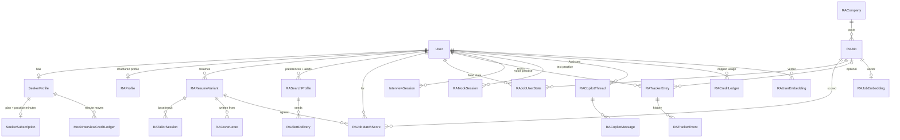

# 05 · Data model and database

As of 2026-11-03 (main @ b89d5256).

RoboApply is one Postgres database (Neon) behind Prisma 7, with no migrations folder: the schema is applied with `prisma db push`, and that one fact drives most of the rules below. Read [§2 of the clone architecture](../jobright-clone/ARCHITECTURE.md) for the full per-area model design. This page is the map and the traps.

## 1. Prisma setup

| Piece | Where | Notes |
|---|---|---|
| Config | [`prisma.config.ts`](../../prisma.config.ts) | Points Prisma at the **folder** `server/prisma/schema/` (every `*.prisma` file in it is loaded). Its migration URL is `DIRECT_DATABASE_URL`, else `DATABASE_URL`, else a dummy `127.0.0.1` URL so `prisma generate` works in builds with no database. |
| Generator + datasource | [`server/prisma/schema/_datasource.prisma`](../../server/prisma/schema/_datasource.prisma) | `provider = "prisma-client"`, output `server/src/generated/prisma`, `moduleFormat = "esm"`, `importFileExtension = "js"`. The `.js` pin exists because the default produced `.ts` imports in some Linux builds and broke at runtime. |
| Generated client | `server/src/generated/prisma/` | Gitignored generated output. Never hand-edit. Regenerate with `npm run db:generate`; `npm install` (postinstall) and `npm run build` also run `prisma generate`. |
| Runtime client | [`server/src/lib/prisma.ts`](../../server/src/lib/prisma.ts) | `@prisma/adapter-pg` over a `pg.Pool`. Import it as `import prisma from '../../lib/prisma.js'`. |
| Versions | `package.json` | Committed: `prisma` and `@prisma/client` 7.10.0. The working tree on 2026-11-03 had someone else's uncommitted bump (`prisma` `^8.0.0-rc.29`, `@prisma/client` `^7.10.1`); `node_modules` holds 8.0.0-rc.29. Treat 7.10 as the supported version until that lands. |

### Pooled vs direct URL

- **Runtime** uses the pooled URL (`DATABASE_URL`, the Neon pgbouncer endpoint). The pooler's TLS handshake is ~2 s against 13–19 s for a cold direct connection. P1017 / "server has closed the connection" errors from the pooler are retried by a `transient-error-retry` `$extends` layer in `lib/prisma.ts`.
- **Schema commands** (`db push`, `migrate diff`, `db execute`) must use `DIRECT_DATABASE_URL`, the non-pooler endpoint. DDL over the transaction-mode pooler can **silently no-op** multi-statement changes.
- Pool size: `PRISMA_POOL_MAX`, else 1 on Vercel and 10 elsewhere. Idle timeout 90 s, connect timeout 30 s.
- [`server/src/lib/databaseUrl.ts`](../../server/src/lib/databaseUrl.ts) also resolves per-bank URLs (`DATABASE_URL_ROBOHIRE`, the GoHire bank) for the cross-bank job search, which opens **read-only** clients onto the RoboHire/GoHire recruiter databases through `createPrismaClientForUrl`. Those are other products' databases. Never write to them.

`lib/prisma.ts` also adds guards to every client: the `User.roles[0] === User.role` invariant is enforced on User writes, and a guard against rescoring a recruiter's manual `JobMatch` fields. Both are inherited from RoboHire.

### Tests never touch a database

[`vitest.config.mts`](../../vitest.config.mts) pins `DATABASE_URL` and `DIRECT_DATABASE_URL` to `127.0.0.1:1`, a closed port, and `lib/prisma.ts` skips `.env` loading under Vitest. Test against fakes or mocked Prisma. HANDOFF §5 also notes that standalone `tsx` scripts which import the server's Prisma client hang. Use `pg` directly or the HTTP API.

## 2. The schema files

`legacy.prisma` holds 149 models (~5,750 lines). The 24 `ra-*.prisma` files hold the RoboApply ("RA") models. All `RA*` tables are RoboApply-only, and by convention they are prefixed `RA` so they don't collide with RoboHire's `RoboApply*` V1 tables.

| File | Domain |
|---|---|
| `_datasource.prisma` | Generator and datasource only. |
| `legacy.prisma` | Inherited RoboHire schema. It holds the shared `User`, `Session`, `AppConfig`, `AdminAdjustment`, `SystemLLMKey`/`UserLLMKey`, `UsageDeductionLog`, `LLMCallLog`, `AlipayOrder`, and the candidate `Seeker*` models (`SeekerProfile`, `SeekerSubscription`, `MockInterviewCreditLedger`, `SeekerConsentRecord`, `SeekerNotification`), `InterviewSession`, and ~115 recruiter-side models that RoboApply code never touches. |
| `ra-platform.prisma` | Durable work queue (`RAWorkItem`), rate/budget counters (`RARateCounter`), hashed auth tokens, OAuth/WeChat identities, product events, surveys, brand invites, TOTP, student verification, admin audit log. |
| `ra-jobs.prisma` | Job inventory: `RAJob` (postings from every source), `RACompany`, ingest planner queries, provider quota usage, H-1B stats, employer career-site sources, job reviews, sponsor register. |
| `ra-match.prisma` | Fit scoring: `RAJobMatchScore` (per user × job × resume), `RAKeywordExtraction`, `RAFitReport`. |
| `ra-feed.prisma` | Feed state: `RAJobUserState` (hidden/viewed/applied click per user×job), interactions, feed sessions, ratings, `RAUserAffinity`. "Liked" is a tracker entry, not a table. |
| `ra-profile.prisma` | Structured candidate profile `RAProfile`, education, experience, and the encrypted `RASensitiveAnswers`. |
| `ra-search.prisma` | `RASearchProfile` (the one preference store, `filters` JSON), `RACareerGoal`, deprecated `RASavedSearch`. |
| `ra-onboarding.prisma` | `RAOnboardingSession` (chat-onboarding state; no FK to User). |
| `ra-resume.prisma` | `RAResumeVariant` (base, tailored and uploaded resumes; self-relation `basedOnVariant`), `RAResumeGrade`, `RATailorSession`. |
| `ra-coverletter.prisma` | `RACoverLetter` (requires a resume variant; carries citations). |
| `ra-tracker.prisma` | `RATrackerEntry` (application tracker row), `RATrackerEvent`, `RAApplicationArtifact` (exact files sent), `RACareerInsight`. |
| `ra-network.prisma` | Contacts from honest sources, contact imports, outreach drafts. |
| `ra-copilot.prisma` | The Assistant: `RACopilotThread`, `RACopilotMessage`, `RACopilotProposal`, `RACopilotMemory`. |
| `ra-agent.prisma` | "Ready to apply" weekly queue: settings, queue items, kit events, answer bank. Never a "submitted" state (ruling D1). |
| `ra-extension.prisma` | Paired browser-extension devices (hashed token), autofill runs, site requests. |
| `ra-credits.prisma` | Usage windows and ledger for capped features, grants, entitlement overrides, cancel survey, refunds, billing-consent archive. |
| `ra-notify.prisma` | Job-alert deliveries, web-push subscriptions, announcements, UI state, email log, anonymous alert subscriptions, unsubscribe feedback. |
| `ra-growth.prisma` | Referral codes, referrals, attribution, growth checklist, referral fraud signals. |
| `ra-prep.prisma` | Interview question bank, contributions and reports, coaches, slots and bookings. |
| `ra-mock.prisma` | `RAMockSession` (the text practice interview) and the deprecated, unused `RAIntegration`. |
| `ra-seo.prisma` | Programmatic SEO browse pages. |
| `ra-cn.prisma` | GoApply/mainland: phone OTPs, campus events and subscriptions, employer blacklist, fraud review, CN referral codes and reports. |
| `ra-compliance.prisma` | AI-content label log, content-safety events, personal-information requests. These are kept after account deletion (no FK cascade). |
| `ra-skills.prisma` | `RASkill`, the canonical skill vocabulary that `RAJob.skillIds` points at (plain ids, no relation). |
| `ra-retrieval.prisma` | `RAJobEmbedding`, `RAUserEmbedding` (`halfvec(1024)` vectors). |

### What "legacy" means in practice

The database was split off RoboHire's on 2026-07-02 (owner's note; not visible in code), but the whole RoboHire schema came along. A rough grep shows about 32 of the 149 legacy models referenced from `server/src`. The rest are dead weight, but **do not delete them from the schema**: `db push` would drop the tables. The legacy models that matter:

- `User`: identity for both brands. `brand` ('roboapply' | 'goapply', default 'roboapply', immutable), `phoneE164` (unique per brand), `lastActiveAt`. `email` is globally unique, not per brand. Login refuses a user of the other brand. `role`/`roles` must satisfy `roles[0] === role` (enforced in `lib/prisma.ts`).
- `SeekerProfile`: every candidate has one. It holds the account soft-delete (`deletedAt`), onboarding state, locale, market and timezone. Login refuses a non-admin user without one; admins get one provisioned at login (`SeekerAuthService.ts`).
- `SeekerSubscription`: the plan (`planKey`, `interval`, `rail` = stripe | alipay | wechatpay, `brand`) and the practice-minute balance `mockCredits`. Every change to that balance writes `MockInterviewCreditLedger`.
- `AlipayOrder`: every CN-rail order. **Frozen**: no edits to the model, its callback or `fulfilPass.ts` (HANDOFF §5; `marketSchema.test.ts` checks the model is byte-identical).
- `AppConfig`: key/value plaintext JSON config. It holds the LLM override blobs `llm_stack.{env}` and `llm_stack.goapply.{env}` ([06](06-ai-and-llm-stack.md)), `credits.catalog.v1`, `rate_card.{env}`, and RoboHire leftovers such as `agent_alex.*` that nothing reads.
- `AdminAdjustment`: the audit trail for admin changes (rate-card saves, `saveLlmStack`, billing adjustments). Editing `AppConfig` by hand bypasses it.
- `SystemLLMKey` / `UserLLMKey`: encrypted provider API keys (platform keys and BYOK).
- `InterviewSession`: one voice mock interview (LiveKit or Parley). It covers the room and dispatch, recording keys in R2, transcript, report, cost and `blueprint`.
- `UsageDeductionLog`, `LLMCallLog`: usage and cost records.

## 3. Core entities



How the main flows sit on these tables:

- **Profile and resumes.** An upload creates an `RAResumeVariant` (`kind` 'base', `isPrimary`, original file pointer `originalFileKey`, `parsedData` JSON). `RAProfile` is the structured profile used for autofill and context. `profileSnapshotForLlm()` is the only context builder for prompts, and it leaves out photo, 籍贯, 政治面貌, gender, birth date, family and EEO answers. A tailoring run (`RATailorSession`) produces a new variant linked by `basedOnVariantId`. The recruiter-side `Resume` model is not used by the candidate product.
- **Jobs.** `RAJob` holds every posting, from boards, job APIs, employer ATS boards, the RoboHire/GoHire banks and user imports. `@@unique([externalId, sourceBoard])`. `dedupeKey` + `isCanonical` collapse duplicates across sources. `market` ('intl' | 'cn') and `visibility` ('public', or private to `ownerUserId` for imports) scope every read. Public counts must filter `visibility='public' AND isCanonical AND archivedAt IS NULL AND market = brand.market` (D3, in the schema comment).
- **Matching.** `RAJobMatchScore` is unique per (user, job, resume variant). Only AI scores (`scoreKind` 'ai') are stored; deterministic pre-scores are computed per request. `tier` is great/good/possible/unlikely. `promptVersion`, `rubricVersion` and the content hashes decide staleness; a model change marks scores stale rather than deleting them.
- **Feed.** `RAJobUserState` (one row per user × job) drives the NOT EXISTS joins of the feed query. Saving a job is an `RATrackerEntry` with status 'bookmarked' and source 'feed'.
- **Tracker.** `RATrackerEntry.status` is `bookmarked | applying | applied | interviewing | negotiating | accepted | rejected | withdrawn`. `jobId` is optional (`externalSnapshot` JSON for jobs not in `RAJob`). Changes are logged as `RATrackerEvent`.
- **Practice interviews.** Two models. `InterviewSession` (legacy file) is the voice engine row; `RAMockSession` is the text practice. Both keep questions, transcript and report as JSON on the row. Their `jobId` is a plain string, not a foreign key.
- **Credits and billing.** Capped AI features (tailor, cover letter, ready kits, …) use `RACreditWindow` (an atomic conditional UPDATE enforces the cap) plus `RACreditLedger` (reserve → commit/release, `idempotencyKey`). Practice minutes are separate: `SeekerSubscription.mockCredits` + `MockInterviewCreditLedger`. Stripe (RoboApply) and Alipay (GoApply) both end in `SeekerSubscription`. See [ARCHITECTURE §7](../jobright-clone/ARCHITECTURE.md).
- **Notifications.** The in-app message center reuses `SeekerNotification` (`templateKey` + `params` JSON for i18n). Job alerts are `RASearchProfile` + `RAAlertDelivery`; push uses `RAPushSubscription`; mail uses `RAEmailLog`.
- **Assistant.** One `RACopilotThread` per conversation (rolling `summary`, token and cost totals) and `RACopilotMessage` rows (`cards` and `toolCalls` JSON). `RACopilotProposal` holds actions waiting for the user's confirmation. `RACopilotMemory` holds facts the user let it keep.
- **Extension, growth, compliance, CN.** See the file table above. Compliance rows (`RAAiContentLabelLog`, `RAContentSafetyEvent`) store `userId` as a plain string on purpose, so they survive the account cascade. `RAPersonalInfoRequest.userId` is SET NULL.

### Conventions worth knowing

- **Enums are strings.** Almost every RA status/kind column is `String` with the allowed values in a `///` comment (`RATrackerEntry.status`, `RAWorkItem.kind`, …). Adding a value then needs no DDL. Postgres enums (a few in legacy) need `ALTER TYPE`, which is not additive.
- **`brand` and `market` columns** are on most RA tables. Brand is per request (Host header); market follows the brand.
- **Some tables have `userId` and no FK** (`RAWorkItem`, `RAOnboardingSession`, `RABillingRefund`, the compliance logs). They don't cascade on account delete, so the purge deletes them explicitly (§6). If you add one, add it to the purge.

## 4. JSON columns: the flexible payloads

JSON is used wherever a shape is expected to grow: an additive field inside JSON needs no schema push, no owner sign-off and no backfill. Examples:

| Column | Holds |
|---|---|
| `InterviewSession.blueprint` | The generated interview plan. `blueprint.prep` holds the `StoredPrep` from the practice-prep agents (requirements, company style, chosen interviewer and focus, market), written at create and kept by prepare. See [PREP_AGENTS.md "Storage (no schema change)"](../interview-practice/PREP_AGENTS.md). |
| `RAMockSession.blueprint` | Same plan for text practice, including `blueprint.prep` and `interviewerBrief`. |
| `InterviewSession.liveMetrics` | Live counters, plus `liveMetrics.voiceSeam` (brand and voice plane) for rows written before the `brand` column existed. |
| `RASearchProfile.filters` | FilterSet v1, with `schemaVersion` and an optimistic-concurrency `version`. |
| `RAJobMatchScore.explanation` / `dimensions` | Per-dimension fit evidence. |
| `RAResumeVariant.parsedData` / `layout` | Parsed resume and template layout. |
| `RACoverLetter.citations`, `RATailorSession.claims` | Every generated sentence cites its source. |
| `SeekerNotification.params`, `RAWorkItem.payload`, `RAProfile.cnFields`/`twFields` | Market- or kind-specific payloads. |

Rules (ARCHITECTURE §2.1 rule 4, observed in code): each JSON shape has a TypeScript type in the owning area's `contract.ts` and is parsed back defensively. For example, `interview-engine/prep/contract.ts` reads `blueprint.prep` tolerantly, so old rows without it still work. The cost of JSON: no indexes, no constraints, and every reader must handle old shapes forever.

## 5. Changing the schema

### The rules

1. **Additive only.** New models, new nullable or defaulted columns, new indexes. No drop, rename, type change, default change or NOT NULL tightening. (HANDOFF §5; `server/prisma/sql/README.md` "What the push must never do".)
2. **There is no migrations folder.** The schema reaches a database through `prisma db push` (`npm run db:push`), or through reviewed SQL applied with `npx prisma db execute --file` (HANDOFF §5's preferred path; the 2026-10-12 production push was a reviewed additive diff applied in one transaction). Never `--accept-data-loss`.
3. **Never push to an unknown database.** Check where `.env` points before any schema command. HANDOFF §2 gives a redacting one-liner: `grep -E '^(DATABASE_URL|DIRECT_DATABASE_URL)=' .env | sed -E 's#://[^@]*@#://<redacted>@#'`. Pushes are confirmed by the owner (AGENTS.md: do not run `db:push` against an unknown database).
4. After any schema edit: `npx prisma validate`, `npm run db:generate`, `npm run typecheck:server`, the relevant tests, and `npx vitest run server/prisma/__tests__`.

### The procedure (from `server/prisma/sql/README.md`)

```bash
# 0. Without a database: is the change additive?
npx prisma validate
node scripts/check-schema-additive.mjs --base main      # default base is the merge-base with feat/jobright-clone
# 1. Against the target DB (DIRECT_DATABASE_URL = non-pooler), read the diff first
npx prisma migrate diff --from-config-datasource --to-schema server/prisma/schema --script > /tmp/before.sql
node scripts/check-schema-additive.mjs --sql /tmp/before.sql
# 2. Show the diff to the owner, apply it (db push or db execute of the reviewed SQL)
# 3. Diff again: it must be empty apart from the KNOWN_DRIFT pairs
npx prisma migrate diff --from-config-datasource --to-schema server/prisma/schema --script > /tmp/after.sql
```

[`scripts/check-schema-additive.mjs`](../../scripts/check-schema-additive.mjs) exits 1 on any drop, rename, type, default or nullability change, and on an edited `Unsupported("…")` type. Reviewed diffs of past pushes are kept in [`docs/jobright-clone/schema-diffs/`](../jobright-clone/schema-diffs/), including the production push `production-2026-10-12-{before,after}.sql`. `KNOWN_DRIFT.md` there lists the one false positive: `RAJob_sourceBoard_externalId_idx`, which Prisma cannot round-trip because of its `text_pattern_ops` operator class.

### Why `db push` is dangerous here

`db push` makes the database equal to the schema. Anything the schema does not declare gets dropped, including tables, columns and indexes created by hand or by another branch.

- **Indexes and extension-typed columns must live in the schema.** The trigram GIN index on `RAJob.searchText` (`ops: raw("gin_trgm_ops")`), the GIN index on `RAJob.searchTsv`, and the `halfvec` columns are all declared in `.prisma` files for this reason. There is no HNSW vector index: Prisma 7.10 cannot declare one, and a hand-made one would be dropped by the next push. Retrieval scans the filtered rows exactly. `sql/README.md` says this needs an owner decision past about 200,000 live rows per market.
- **The unmerged-branch drift trap.** Every branch and worktree points at the same few databases. A branch that pushed and never merged leaves its columns behind. A later `migrate diff` from `main` then reports them as drift, and a push from `main` would drop them, possibly with data. Before calling a drifted column dead, search every local and remote branch and worktree schema (`git log --all -S "<column>" -- server/prisma`). The owner's notes record one real case (`RATrackerEntry.deletedAt`, Aug 2026). On 2026-11-03 no branch had schema changes that `main` lacks.
- **`Unsupported` types.** Never edit the type inside `Unsupported("…")` of an existing column. For `halfvec(1024)` → `halfvec(1536)`, Prisma prints an empty diff and the database silently keeps the old type. A new dimension needs a new column or table.

### Databases

Unverified by this author; from HANDOFF §2 and §6 and the owner's notes:

| Database | Endpoint (no credentials) | What it is |
|---|---|---|
| Production | Neon project "RoboApply", `ep-empty-snow-a6mdqwbe` | Live data. Pushed with the market-wave schema on 2026-10-12. The owner's notes say the **main checkout's `.env` points here**. |
| Clone branch | Neon branch `jobright-clone`, `ep-quiet-king-a6psbfbe` | A copy of production (real users' rows), used by the clone worktree. |
| Old shared DB | RoboHire `neondb` | RoboApply's home before 2026-07-02. It holds real RoboHire customers. Never write to it. |

Because a local API runs the platform crons in process (alerts, mail, push, queue drain, account purge), `npm run dev` against these databases acts on real users. Set `ROBOAPPLY_CRON_DISABLED=true` in `.env.local` for local work (HANDOFF §3).

### Extensions: `server/prisma/sql/`

[`server/prisma/sql/`](../../server/prisma/sql/) holds only extension installs, run **once per database, by hand, before the push that needs them**. Nothing runs them automatically.

- `000_extensions.sql`: `pg_trgm` (for the trigram index).
- `001_vector.sql`: `vector` (pgvector ≥ 0.7.0 for `halfvec`; production has 0.8.6).

Neon ships both. The mainland RDS instance has not been confirmed to offer pgvector ≥ 0.7.0 (sql/README "Databases that are not Neon"). Until it is, a mainland database cannot run code from the market wave on.

### Schema tests: `server/prisma/__tests__/`

Both read schema text only, with no database and no engine:

- `checkSchemaAdditive.test.ts`: unit tests of the additive classifier and the KNOWN_DRIFT reader in `scripts/check-schema-additive.mjs`.
- `marketSchema.test.ts`: asserts that every model, column and index the market-wave code depends on exists, and that the pre-wave fields of touched models are unchanged (a `FROZEN` list from commit `03b140f`). `AlipayOrder` must be byte-identical. A new field on those models extends the expected lists. Never make it pass by editing `FROZEN`.

## 6. Data lifecycle

### Account deletion

1. **Soft close.** `POST /api/v1/roboapply/account/delete` sets `SeekerProfile.deletedAt` and revokes sessions (`SeekerAuthService.softDeleteAccount`).
2. **Hard purge.** [`SeekerAccountPurgeService.ts`](../../server/src/roboapply/services/SeekerAccountPurgeService.ts) runs daily at 04:00 UTC: the Vercel cron `/api/v1/cron/account-purge`, and in process in any local API unless `ROBOAPPLY_CRON_DISABLED=true`. HANDOFF §6 noted that `CRON_SECRET` was unset on Vercel on 2026-10-12, so production crons answered 401; check whether that is still true. It purges accounts closed more than `ACCOUNT_PURGE_RETENTION_DAYS` ago (default 30; GoApply at most 15 for PIPL). The order matters, and every step must succeed before the next:
   1. Delete R2 interview recordings and transcripts, resume originals and application artifacts. Storage goes first because the rows hold the only pointers.
   2. Cancel a running Stripe subscription (RoboApply only).
   3. Copy minimal proof of the checkout consents into `RABillingConsentArchive`.
   4. Delete rows with no FK (`RAOnboardingSession`, `RAWorkItem`, `RABillingRefund`, product events of linked anon ids).
   5. Delete the `User`; `onDelete: Cascade` removes the rest.

   A user whose storage or subscription step fails is left in place and retried. Only pure seeker/candidate role sets are purged. Admin or multi-role users are logged for manual review.
3. **PIPL withdrawal** (GoApply): [`features/compliance/purge.ts`](../../server/src/features/compliance/purge.ts) closes the account and calls `purgeAccountNow`.

Never run `account-purge` or `queue-drain` locally against production or the clone branch. The purge deletes shared-bucket files of real soft-deleted users.

### Retention

[`features/compliance/retention.ts`](../../server/src/features/compliance/retention.ts) is one `RETENTION_RULES` table. The same table drives the `compliance-daily` deletions, the privacy notices and the Settings → Privacy page, so changing a period changes all three. Current periods:

| What | Kept for |
|---|---|
| Assistant messages | 12 months |
| Job interactions, feed impressions, product events | 13 months |
| Soft-deleted cover letters, tracker entries, Assistant memories, resumes (`deletedAt`) | 30 days. A resume still used by a live cover letter is held back, because deleting it would cascade the letter. |
| Application artifacts, AI-label logs, content-safety events | 180 days |
| Practice recordings and transcripts | 90 days (`features/interview/retention.ts`) |
| Expired auth tokens | 24 h |
| Known-device marks | 90 days |
| Billing consent records | At least 3 years; archived past account deletion |
| Inactive accounts (24 months) | Listed as a commitment; `not_automated` |

### Encrypted and hashed fields

| Data | Protection | Key |
|---|---|---|
| `SystemLLMKey`, `UserLLMKey` (provider API keys) | AES-256-GCM, [`lib/crypto.ts`](../../server/src/lib/crypto.ts) | `FIELD_ENCRYPTION_KEY` (64 hex chars, or a passphrase derived with scrypt) |
| `RASensitiveAnswers.ciphertext` (EEO; 籍贯/政治面貌/family/photo id) | AES-256-GCM with user id as AAD, [`features/profile/sensitiveCrypto.ts`](../../server/src/features/profile/sensitiveCrypto.ts) | `SENSITIVE_DATA_KEY` (+ `_VERSION`, `_PREVIOUS` for rotation). No key: reads return nothing and writes are refused. |
| `RATwoFactor.secretSealed` | AES-256-GCM, `features/account-v2/sealing.ts` | `TOTP_ENCRYPTION_KEY` (GoApply: `CN_TOTP_ENCRYPTION_KEY`, else shared) |
| Auth tokens, extension device tokens, OTP codes, recovery codes, school emails | sha256 hashes only | none |
| `RAIntegration.accessToken/refreshToken` | Plain text | Model deprecated; no code reads it |

Encrypted rows are tied to the key of the deployment that wrote them. Copying `SystemLLMKey` rows to a database with a different `FIELD_ENCRYPTION_KEY` makes them undecryptable. The system tier then logs and falls back to the env key; in July 2026 that silently produced empty `Authorization` headers. Re-enter keys after any data copy.

## 7. Stale or contradictory docs

- `AGENTS.md` ("Prisma's source schema is `server/prisma/schema.prisma`") and the `README.md` layout block describe the old single-file schema. The source is the folder `server/prisma/schema/`.
- `README.md` and the header comment of `prisma.config.ts` say the database is shared with RoboHire. Per the owner's notes it was split onto its own Neon project on 2026-07-02.
- `lib/prisma.ts` says the CLI gets the direct URL "via `directUrl` in schema.prisma". It comes from `prisma.config.ts`.
- `docs/jobright-clone/HANDOFF.md` §2 says "Nothing from this work is on `main`". The clone was merged and shipped (PR #4).
- HANDOFF §5 prefers reviewed SQL via `prisma db execute`; `sql/README.md` and `AGENTS.md` say `npm run db:push`. Both are in use. Whichever you use, run the before and after diffs.
